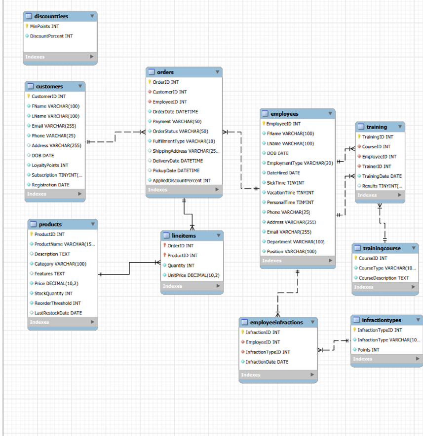
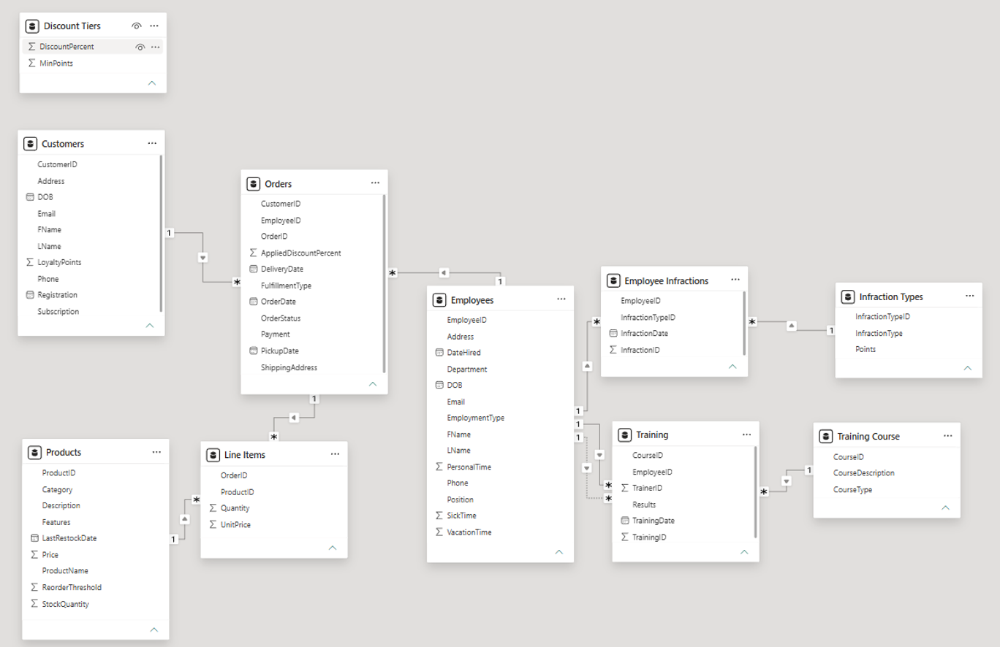

# HomeCoded: Turning Questions Into Queries

**A MySQL database for TechNest, a fictional furniture store, that turns everyday business rules into tested SQL.**

*Presented by HomeCoded, a fictional coding company.*

Hi, I'm Joshua Gonzalez. This project follows a business from its rules all the way to the queries a manager would actually run. I designed a 10-table MySQL database, generated sample data in Python, and wrote SQL that answers practical questions: which products need restocking, which customers are close to the loyalty point cap, which employee earned this year's sales bonus, and more.

The part I'm proudest of is the testing. Before running each query, I planted specific cases in the data and wrote down exactly what the query *should* return. Then I confirmed that it did.

This is also version 2. I rebuilt the project after going back to my first attempt and finding real problems in it, and you can see [what changed](#what-changed-from-version-1) below.

**See the full project:** [Presentation (PDF)](docs/%28MAIN%29SQLHomeCodedProjectV2.pdf)

**Let's connect:** [LinkedIn](https://www.linkedin.com/in/joshua-gonzalez-pitt)

---

## At a glance

- **Database:** MySQL, 10 tables, 312 rows of sample data
- **Business rules:** 25, each mapped to how it's handled ([see coverage](#business-rule-coverage))
- **Queries:** 18 total, including simple queries, multi-table joins, a customer invoice, calculations, and subqueries
- **Sample data:** Python (Jupyter Notebook), mysql-connector-python, Faker
- **Validation:** Planted test cases with known expected results, plus a Power BI data model to confirm table relationships
- **Skills shown:** Relational schema design; CHECK, UNIQUE, and foreign key constraints; joins; subqueries; common table expressions (CTEs); window functions; parameterized SQL

**Contents:** [Database design](#database-design) · [How I tested it](#how-i-tested-it) · [Business rule coverage](#business-rule-coverage) · [Queries](#queries) · [Sample data](#sample-data) · [What changed from version 1](#what-changed-from-version-1) · [How I used AI](#how-i-used-ai) · [Repository structure](#repository-structure) · [How to run it](#how-to-run-it)

---

## Database design



*Entity relationship diagram, built in MySQL Workbench*

| Table | What it holds | Rows |
|---|---|---|
| `customers` | Contact info, loyalty points, membership status | 30 |
| `orders` | Order date, payment, status, fulfillment details, applied discount | 50 |
| `lineitems` | Products on each order, with the price at the time of sale | 102 |
| `products` | Catalog, price, stock level, reorder threshold | 25 |
| `discounttiers` | Loyalty point thresholds and their discount percentages | 7 |
| `employees` | Job details, hire date, time-off balances | 25 |
| `infractiontypes` | Infraction categories and their point values | 5 |
| `employeeinfractions` | Each recorded infraction and its date | 15 |
| `trainingcourse` | Training course catalog | 3 |
| `training` | Each employee's course attempts, trainer, and result | 50 |

**Design choices worth a look**

- **Prices are saved at the time of sale.** `lineitems.UnitPrice` and `orders.AppliedDiscountPercent` store what the customer actually paid, so past invoices stay accurate even if a product's price or a customer's loyalty points change later.
- **Fulfillment rules live in the table itself.** A CHECK constraint on `orders` requires shipped orders to have a shipping address and no pickup date, and pickup orders to have no shipping address or delivery date.
- **Employees can be both trainees and trainers.** The `training` table references `employees` twice: once for the person taking the course and once for the trainer who approved it.
- **Discount tiers stand alone on purpose.** Customers qualify for a tier by point *range* (for example, 1,000 to 1,999 points earns 15%), so `discounttiers` is matched by range rather than linked with a foreign key.

I also rebuilt the relationships in Power BI to confirm everything connects the way the ERD says it should. The dotted line between `Employees` and `Training` is the second, trainer relationship.



*Data model in Power BI*

---

## How I tested it

To check the logic and not just the syntax, I planted specific cases in the sample data, wrote down the expected result ahead of time, and compared it to what each query returned.

| Rule | What I planted in the data | Expected result |
|---|---|---|
| 5. Staff Training | 50 training records, including two failures | Employees 1 and 2 flagged for failed Basic Enrollment Training |
| 8. Attendance | Employee 4 has 17 active points, Employee 11 has 9, and Employee 1's points have all expired | Only Employee 4 reaches the 15-point termination threshold |
| 6 & 8. Clean Records | 15 employees have no infractions; Employee 1 has only expired ones | 16 employees with no active infractions, including Employee 1 |
| 10. Time Off Eligibility | Employee 23 has 2 sick days about 60 days after being hired | Employee 23 flagged for PTO before six months |
| 15. Minors' Employment | Employee 24 is 16 and full-time; Employee 25 is 15 and part-time | Employee 24 flagged, Employee 25 compliant |
| 18. Loyalty Point Limit | Customers 28, 29, and 30 have 2,200, 2,800, and 3,000 points | All three returned for a reminder |
| 22. Restock | Products 1 through 4 are below their reorder thresholds | All four returned for restocking |
| 24. Membership | Customer 1 is the only nonmember and has no orders | 29 members, 1 nonmember, and zero nonmember orders |
| Products Not Selling | Product 25 was left out of recent orders | Product 25 returned, along with any other product with no sales in the last 90 days |

Every query returned its expected result.

---

## Business rule coverage

Not every business rule belongs in a database, and the ones that do can't all be enforced the same way. Here's how each rule is handled:

- **Prevented:** A constraint makes the database reject bad data.
- **Built in:** The table design makes a violation impossible.
- **Checked by query:** A query finds violations, or produces the numbers the rule depends on.
- **Out of scope:** A workplace policy with no data to check in this project.
- **Known gap:** Would need a schema change to check.

**Why are some rules checked instead of prevented?** MySQL CHECK constraints can only look at the row being saved, and they can't use today's date. Rules that depend on time (PTO eligibility, a minor's age, infraction points expiring) or on another table (membership at checkout) are handled with queries instead.

| # | Rule | How it's handled | Details |
|---|---|---|---|
| 1 | Business Hours | Out of scope | Not stored in the database. The sample data follows the store's hours (Sunday through Friday, 9 AM to 8 PM, closed Saturdays) and the 6 AM to 8 PM pickup window. |
| 2 | Confidentiality & Data Protection | Out of scope | Workplace policy. In the code, the MySQL password is entered with `getpass()` instead of being saved in the notebook. |
| 3 | Copyright & Intellectual Property | Out of scope | Workplace policy |
| 4 | Pricing & Promotions | Out of scope | Seasonal promotions aren't modeled; loyalty discounts are (Rule 25) |
| 5 | Staff Training | Built in + Checked by query | `training` records each course, trainer, and pass/fail result. *Training Results* query |
| 6 | Uniform Policy | Checked by query | Dress code violations are logged as infractions. *Employee Infraction Details* query |
| 7 | Breaks and Lunches | Out of scope | No shift or time-clock data |
| 8 | Attendance Policy | Built in + Checked by query | Point values live in `infractiontypes`. *Employee Infraction Details*, *No Active Infractions*, and *Termination Threshold* queries handle the one-year expiration |
| 9 | Promotion Eligibility | Out of scope | No position history is stored |
| 10 | Vacation Time Eligibility | Checked by query | *Time Off Eligibility* query (depends on today's date) |
| 11 | Workplace Safety | Out of scope | Workplace policy |
| 12 | Total Time Off Limitations | Prevented + Checked by query | CHECK constraints cap sick (9), vacation (14), and personal (7) days, which also keeps the total within 30. *Total PTO Check* query audits balances |
| 13 | Commission Bonus | Checked by query | *Highest-Selling Employee* query ranks sales after discounts with `RANK()`, so if employees tie for the top spot, each one qualifies |
| 14 | Single Job Title | Built in | Each employee has one `Department` and one `Position` |
| 15 | Minors' Employment | Checked by query | *Minor Employment Check* query calculates age from date of birth (depends on today's date) |
| 16 | Employee Orders | Known gap | Orders record which employee processed them, but nothing links an employee to their own customer account |
| 17 | Unique Emails/Phone Numbers | Prevented | UNIQUE constraints on `Email` and `Phone` in both `customers` and `employees` (enforced within each table) |
| 18 | Loyalty Point Limitation | Prevented + Checked by query | CHECK caps points at 3,000. *Loyalty Points Notification* query lists customers at 2,000 or more |
| 19 | Shipping Policy | Prevented + Out of scope | CHECK limits fulfillment to Ship or Pickup and requires the matching address and date fields. Shipping costs come from USPS rates and aren't stored in the database |
| 20 | Return Policy | Checked by query | *Return Eligibility* query classifies orders by return window; product condition is confirmed when the item comes back |
| 21 | Payment Limit | Built in | Each order has a single `Payment` field |
| 22 | Restock | Checked by query | *Restock Threshold* query, supported by *Product Sales Performance* |
| 23 | Product Demonstrations | Out of scope | In-store policy; no demonstration records are stored |
| 24 | Membership | Checked by query | *Membership Counts* and *Nonmember Purchase Check* queries (a CHECK constraint on `orders` can't look up the customer's membership) |
| 25 | Loyalty Discounts | Built in | Tiers are stored in `discounttiers`. The discount applied at checkout is saved on each order and shown on the *Customer Invoice* |

---

## Queries

**[Simple queries](sql/04_simple_queries.sql):** Time Off Eligibility · Loyalty Points Notification · Return Eligibility · Restock Threshold · Membership Counts

**[Complex queries (multi-table joins)](sql/05_complex_queries.sql):** Training Results · Employee Infraction Details · Highest-Selling Employee · Product Sales Performance · Nonmember Purchase Check

**[Customer invoice](sql/06_customer_invoice.sql):** An itemized invoice for a selected order, with fulfillment details, payment method, saved prices, loyalty discount, and order total

**[Calculations](sql/07_calculations.sql):** Total PTO Check · Minor Employment Check

**[Subqueries](sql/08_subqueries.sql):** No Active Infractions · Above-Average Customer Orders · Products Not Selling · Termination Threshold · Popular Products

*Above-Average Customer Orders, Products Not Selling, and Popular Products aren't tied to a single rule. They answer everyday business questions about frequent customers, slow sellers, and best sellers.*

---

## Sample data

I generated the sample data in a Jupyter Notebook and inserted it straight into MySQL with mysql-connector-python.

- **Realistic details:** Faker provides names and addresses, and fixed random seeds make the generated values repeatable.
- **Rule-aware generation:** Shipped orders get a shipping address and delivery date, and pickup orders get a pickup date. Each order's status matches how long ago it was placed, and each discount comes from the customer's loyalty tier.
- **Planted test cases:** Specific records deliberately break business rules so the checking queries have known answers (see [How I tested it](#how-i-tested-it)).
- **Safe database code:** Inserts use parameterized SQL, which avoids quoting errors and protects against SQL injection. The database password is entered with `getpass()`, so it's never saved in the notebook.

---

## What changed from version 1

Going back to my first version with fresh eyes, I found problems I hadn't noticed the first time. Fixing them taught me more than the original build did.

Want to see the difference for yourself? Compare the [original version 1 presentation](docs/%28ORIGINAL%29SQLHomeCodedProjectV1.pdf) with the [current version 2 presentation](docs/%28MAIN%29SQLHomeCodedProjectV2.pdf).

| | Version 1 | Version 2 |
|---|---|---|
| **Tools** | Queries run in a browser-based SQL tool, with sample data added through individual INSERT statements | A local MySQL server and Workbench, sample data generated in Python, and relationships checked in Power BI |
| **Business rules** | Some rules didn't match the data. The shipping rule said every order ships, yet the data had pickups, and no rule defined the loyalty discount tiers | Rules rewritten to be specific and testable, including in-store pickup and the loyalty discount tiers |
| **Protecting the data** | No NOT NULL (beyond the keys), UNIQUE, or CHECK constraints, so nothing stopped bad data from being saved | Constraints enforce the rules that can live in the tables themselves, from PTO caps to unique emails |
| **Stored vs. calculated values** | Some values that go out of date were stored, like time worked saved as text ("3 years") and a running points total | These are calculated from dates when the query runs, so they're always current |
| **Prices and discounts** | Sales totals used each product's *current* price. The invoice calculated discounts two different ways, so it could show 10% off while charging 20% | The price and discount are saved with each order, and the tiers live in their own table |
| **Fulfillment** | Some orders had a shipping address, a pickup date, and a delivery date all at once | A `FulfillmentType` column and a CHECK constraint allow only valid combinations |
| **Diagram vs. code** | The ERD and the CREATE TABLE statements disagreed on some column names and data types | The ERD matches the tables, and I confirmed the relationships again in Power BI |
| **Sample data** | A few inserts wouldn't run as written (a misspelled column, and an INSERT listing more columns than values), and many customers were named after celebrities | Generated with Python and Faker, inserted with parameterized SQL, and designed around the rules |
| **Testing** | No planted test cases, so several checks came back "all clear" or empty, which didn't prove anything | Planted test cases with known expected results, laid out before each set of queries |
| **Query logic** | A few silent bugs: the minors check never looked at employment type, the infraction queries ignored the one-year point expiration, and one query returned nothing for the wrong reason (below) | Each one fixed and checked against expected results |

**My favorite catch:** Version 1's *Products Not Selling* query looked for `ProductID` in the `orders` table, which doesn't have that column. Instead of raising an error, MySQL matched it to the outer query's `products` table, so the check could never find anything and returned an empty result that *looked* like "every product is selling." Version 2 joins line items to orders and uses `NOT EXISTS`, and it correctly returns every product with no recent sales, including the planted Product 25.

The biggest lesson from the rebuild: a query that runs isn't necessarily a query that's right. That's why version 2 is built around test cases.

---

## How I used AI

AI was one of the tools on this project, alongside MySQL Workbench, Python, and Power BI. I used it where it saved time and kept the thinking and decisions my own.

**Where AI helped**

- **Rebuilding version 1.** I used AI as a reviewer and sounding board to find weak spots in my original design and queries and to talk through stronger approaches. I evaluated each suggestion before deciding whether to use it.
- **Cutting down repetitive work.** Boilerplate code, consistent formatting, and documentation drafts (including this README) went faster with AI's help.
- **A second set of eyes.** After the rebuild, an AI review flagged a few remaining issues, such as duplicated business rules, a mislabeled slide, and a bonus query that didn't account for ties. I verified each one and fixed it.

**What was mine**

- The business rules, and the decision about how each one should be enforced
- The database design: the tables, how they relate, and which constraints protect them
- The sample data: what each customer and employee record needed to contain, and which records deliberately break which rules
- The test cases, their expected results, and checking every query against them

**Ground rules I followed**

- Every record in this project is fictional, so no real customer or company data was ever shared with an AI tool.
- Nothing went into the final project unless I had tested it and understood why it works.

---

## Repository structure

```
├── README.md
├── images/
│   ├── erd.png
│   └── powerbi-data-model.png
├── sql/
│   ├── 01_create_tables.sql
│   ├── 02_sample_data.sql
│   ├── 03_check_row_counts.sql
│   ├── 04_simple_queries.sql
│   ├── 05_complex_queries.sql
│   ├── 06_customer_invoice.sql
│   ├── 07_calculations.sql
│   └── 08_subqueries.sql
├── python/
│   ├── TechNest_Data.ipynb
│   └── requirements.txt
└── docs/
    ├── (MAIN)SQLHomeCodedProjectV2.pdf
    └── (ORIGINAL)SQLHomeCodedProjectV1.pdf
```

---

## How to run it

**Requirements**

- MySQL 8.0.16 or later (earlier versions accept CHECK constraints but don't enforce them)
- Python 3 with the packages in `python/requirements.txt` (Jupyter, mysql-connector-python, and Faker)

**Steps**

The SQL files are numbered in the order to run them.

1. Run `sql/01_create_tables.sql`. It creates the `technest` database and all 10 tables.
2. Load the sample data using either option:
   - **Quick:** Run `sql/02_sample_data.sql`.
   - **Regenerate:** Install the packages with `pip install -r python/requirements.txt`, then run `python/TechNest_Data.ipynb`. It connects to your local MySQL server and asks for your password when it starts.
3. Run `sql/03_check_row_counts.sql` to confirm the data loaded. You should see 312 rows across 10 tables.
4. Run any of the query files (`04` through `08`). Each query has a comment above it with the question it answers and its expected result.

**A note on dates**

Several queries compare against today's date with `CURDATE()` and `NOW()`, the way a live system would. That means their results change over time. For example, Employee 23 stops being flagged for early PTO once they pass six months on February 24, 2027. The results shown in the presentation were captured in late October 2026.

---

Thanks for taking a look! If you have questions about the project or want to talk data, I'd love to hear from you on [LinkedIn](https://www.linkedin.com/in/joshua-gonzalez-pitt).
